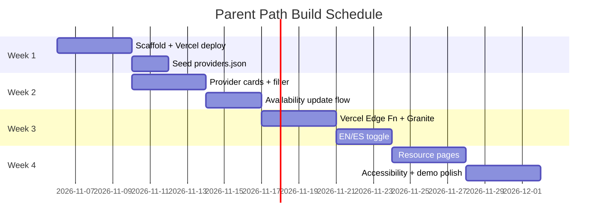

# I'm building Parent Path, a free web tool for parents in Broward County, Florida navigating children's intervention services:
Florida's Early Steps program (birth to 3)
The transition to school district services at age 3
Finding speech, OT, and behavioral therapy providers
Requesting school evaluations and IEPs

Key problem: providers listed as "accepting new patients" often aren't, because their status isn't updated with insurers. I want parent-reported availability updates (with a "last verified" date) so the list stays honest.                                                      Context: This is for the IBM AI for Good Challenge (deadline Dec 2, 2026). I'm building solo in 30-60 minute sessions, 3-4 times a week. The repo is MannyDC88/parent-path.

Requirements:
AI is a core feature. I'd like to use IBM Granite as the in-app AI model (free options: watsonx.ai Lite, Replicate, or Ollama locally), and consider Granite Guardian for safety screening.
Privacy-first: collect minimal data, no child names or diagnoses stored.
English and Spanish.
Accessible and mobile-friendly.
Simple enough for one person to build and deploy free.                                    Background to save back-and-forth:
I have experience with React, Python, and building AI chatbots.
Free hosting is required (e.g., Vercel, Netlify, Render).
No user accounts or logins for the MVP.
Provider data: start with a small hand-curated seed list (about 15-25 Broward providers) in a JSON or simple database.
The demo must work reliably for a 3-minute recorded video.
I have a limited Bob budget, so keep this plan concise.                                    Please:
1. Define a tight MVP (what's in, what's out).
2. Recommend a simple tech stack and explain why.
3. Lay out a 4-week plan (Nov 6 - Dec 1).
4. Create SPEC.md (MVP, stack, architecture, responsible AI approach), NEXT.md (the very next 3 tasks), and devlog.md (dated entries of what we did and how Bob helped).

If anything is unclear, make a reasonable assumption and list it in SPEC.md under "Assumptions" instead of asking. Do not write app code yet.

---

**Status:** active  **Date:** 2026-11-06

---

### 👤 User

I'm building Parent Path, a free web tool for parents in Broward County, Florida navigating children's intervention services:
Florida's Early Steps program (birth to 3)
The transition to school district services at age 3
Finding speech, OT, and behavioral therapy providers
Requesting school evaluations and IEPs

Key problem: providers listed as "accepting new patients" often aren't, because their status isn't updated with insurers. I want parent-reported availability updates (with a "last verified" date) so the list stays honest.                                                      Context: This is for the IBM AI for Good Challenge (deadline Dec 2, 2026). I'm building solo in 30-60 minute sessions, 3-4 times a week. The repo is MannyDC88/parent-path.

Requirements:
AI is a core feature. I'd like to use IBM Granite as the in-app AI model (free options: watsonx.ai Lite, Replicate, or Ollama locally), and consider Granite Guardian for safety screening.
Privacy-first: collect minimal data, no child names or diagnoses stored.
English and Spanish.
Accessible and mobile-friendly.
Simple enough for one person to build and deploy free.                                    Background to save back-and-forth:
I have experience with React, Python, and building AI chatbots.
Free hosting is required (e.g., Vercel, Netlify, Render).
No user accounts or logins for the MVP.
Provider data: start with a small hand-curated seed list (about 15-25 Broward providers) in a JSON or simple database.
The demo must work reliably for a 3-minute recorded video.
I have a limited Bob budget, so keep this plan concise.                                    Please:
1. Define a tight MVP (what's in, what's out).
2. Recommend a simple tech stack and explain why.
3. Lay out a 4-week plan (Nov 6 - Dec 1).
4. Create SPEC.md (MVP, stack, architecture, responsible AI approach), NEXT.md (the very next 3 tasks), and devlog.md (dated entries of what we did and how Bob helped).

If anything is unclear, make a reasonable assumption and list it in SPEC.md under "Assumptions" instead of asking. Do not write app code yet.

---

### 🤖 Assistant

> 🔧 called: use_skill


> 🔧 **use_skill** — create-plan

### 🤖 Assistant

> 🔧 called: spawn_subagent

The user has provided comprehensive requirements — no clarifying questions needed. Let me explore the existing repo structure before writing the plan.

> 🔧 **spawn_subagent** — explore

### 🤖 Assistant

> 🔧 called: update_todo_list

Clean slate. Now I have everything I need to write all three files and the plan.

> 🔧 **update_todo_list** — [-] Write SPEC.md, NEXT.md, devlog.md, and parent-path-plan.md


### 🤖 Assistant

> 🔧 called: write_file


> 🔧 **write_file** — c:\Users\ManuelCastillo\Projects\parent-path\SPEC.md

### 🤖 Assistant

> 🔧 called: write_file


> 🔧 **write_file** — # NEXT — Immediate Next 3 Tasks

> Updated: 2026-11-06
> Status: Week 1 — Project Scaffold

---

## Task 1 · Scaffold the React + Vite project

**Goal:** Get a working app shell running locally and deployed to Vercel.

Steps:
1. Run `npm create vite@latest . -- --template react` in the repo root
2. Install dependencies: `npm install`
3. Install Tailwind CSS: `npm install -D tailwindcss postcss autoprefixer` → `npx tailwindcss init -p`
4. Configure `tailwind.config.js` to scan `./src/**/*.{js,jsx}`
5. Add Tailwind directives to `src/index.css`
6. Replace the Vite boilerplate in `src/App.jsx` with a minimal shell (header, main, footer)
7. Push to GitHub → connect repo to Vercel → confirm live deploy URL

**Done when:** `https://<your-vercel-url>.vercel.app` loads a page that says "Parent Path" in both English and Spanish.

---

## Task 2 · Create `providers.json` seed data

**Goal:** Hand-curate ~20 Broward County therapy providers in a structured JSON file.

Steps:
1. Create `/public/data/providers.json`
2. Schema per provider:
   ```json
   {
     "id": "unique-slug",
     "name": "Provider or Practice Name",
     "specialties": ["speech", "OT", "behavioral"],
     "insurances": ["Medicaid", "Florida Blue", "Sunshine Health"],
     "city": "Fort Lauderdale",
     "phone": "954-555-0100",
     "website": "https://example.com",
     "availability": "unknown",
     "lastVerified": null,
     "notes": ""
   }
   ```
3. Add 15–20 real or representative Broward providers (speech therapists, OT clinics, ABA providers)
4. Validate the JSON is well-formed

**Done when:** `/public/data/providers.json` contains ≥15 entries and passes `JSON.parse` without errors.

---

## Task 3 · Build the `ProviderCard` component + Home page list

**Goal:** Render the provider list on the Home page with a basic filter.

Steps:
1. Create `src/components/ProviderCard.jsx` — displays name, specialties, city, phone, website link
2. Create `src/components/AvailabilityBadge.jsx` — colored badge showing "Accepting" / "Waitlist" / "Unknown" + last-verified date
3. Create `src/pages/Home.jsx` — fetches `providers.json`, renders a grid of `ProviderCard` components
4. Add a specialty filter (All / Speech / OT / Behavioral) above the grid
5. Wire `Home` into `App.jsx`

**Done when:** The home page shows all providers as cards with their availability badge, and the filter buttons correctly narrow the list.


### 🤖 Assistant

> 🔧 called: write_file


> 🔧 **write_file** — # Dev Log — Parent Path

> A running record of build sessions and how Bob helped.

---

## 2026-11-06 · Session 1 — Project Planning

**What we did:**
- Defined the MVP scope for the IBM AI for Good Challenge (deadline Dec 2, 2026)
- Chose tech stack: React + Vite + Tailwind CSS, Vercel hosting, IBM Granite via watsonx.ai Lite, Vercel Edge Function as API proxy
- Decided on localStorage for availability updates (serverless, privacy-preserving)
- Selected react-i18next for EN/ES bilingual support
- Decided against a Python backend to ensure reliable free hosting (no Render cold-start during demo)
- Created SPEC.md, NEXT.md, and this devlog
- Created parent-path-plan.md with a 4-week subtask breakdown

**How Bob helped:**
- Explored the repo (clean slate — just README + LICENSE)
- Drafted the full SPEC.md including architecture diagram, responsible AI table, 4-week schedule, and assumptions
- Drafted NEXT.md with the first 3 actionable tasks
- Created the implementation plan file

**Decisions made:**
- Granite Guardian implemented as a system prompt instruction (not a separate endpoint) — assumption documented in SPEC.md
- AI responses English-only for MVP; UI strings bilingual
- Availability updates are localStorage-only (no sync across devices) — known limitation

**Next session:** Scaffold the Vite/React project and deploy to Vercel (NEXT.md Task 1)


### 🤖 Assistant

> 🔧 called: write_file


> 🔧 **write_file** — # Parent Path — Implementation Plan

> IBM AI for Good Challenge · Nov 6 – Dec 1, 2026
> Stack: React + Vite + Tailwind · watsonx.ai Granite · Vercel
> See SPEC.md for full context.

---

## Overview

Build a bilingual, mobile-friendly web tool for Broward County parents navigating early intervention services. The app has four pillars: a curated provider directory with parent-reported availability, an IBM Granite AI chat navigator, static resource pages (Early Steps, age-3 transition, IEP), and an EN/ES language toggle. No backend — all data is static or proxied through a Vercel Edge Function.

---

## Sub-Task 1 — Project Scaffold and Vercel Deploy

**Status:** `[ ] pending`

**Intent:** Create a working React + Vite + Tailwind app shell with a minimal layout, push to GitHub, and confirm a live Vercel deployment. This is the foundation every other sub-task builds on.

**Expected Outcomes:**
- `npm run dev` starts the app without errors
- The app renders a header with "Parent Path", a placeholder main area, and a footer
- The Vercel URL is live and accessible

**Todo List:**
1. Run `npm create vite@latest . -- --template react` in the repo root
2. Run `npm install`
3. Install and configure Tailwind CSS (`tailwindcss`, `postcss`, `autoprefixer`)
4. Add Tailwind directives to `src/index.css`
5. Replace Vite boilerplate in `src/App.jsx` with a minimal shell layout (header, main, footer)
6. Commit and push to GitHub (`MannyDC88/parent-path`)
7. Connect repo to Vercel; confirm environment variable support is working
8. Verify the live Vercel URL loads

**Relevant Context:**
- Repo: `MannyDC88/parent-path` (currently has only README + LICENSE)
- Hosting: Vercel free tier (static + Edge Functions)
- See SPEC.md §3 Tech Stack and §4 Architecture

---

## Sub-Task 2 — Provider Seed Data

**Status:** `[ ] pending`

**Intent:** Create the `providers.json` flat file with 15–20 curated Broward County therapy providers. This is the core data the entire directory feature depends on.

**Expected Outcomes:**
- `/public/data/providers.json` exists and is valid JSON
- Contains ≥15 entries with all required fields
- Covers all three specialties: speech, OT, behavioral

**Todo List:**
1. Create `/public/data/providers.json`
2. Use the schema defined in `NEXT.md` Task 2 (id, name, specialties, insurances, city, phone, website, availability, lastVerified, notes)
3. Add 15–20 Broward providers across speech therapy, occupational therapy, and behavioral/ABA
4. Set `availability: "unknown"` and `lastVerified: null` for all seed entries
5. Validate JSON is well-formed

**Relevant Context:**
- File lives in `/public/` so Vite serves it as a static asset
- Schema defined in `NEXT.md` Task 2
- See SPEC.md §2 MVP Scope (provider directory row)

---

## Sub-Task 3 — Provider Directory UI

**Status:** `[ ] pending`

**Intent:** Build the Home page that fetches `providers.json` and renders provider cards with availability badges and a specialty filter. This is the most-used screen in the app.

**Expected Outcomes:**
- Home page fetches and displays all providers as cards
- Each card shows: name, city, specialties, phone, website link, and availability badge
- Specialty filter (All / Speech / OT / Behavioral) narrows the list
- Layout is responsive (stacks on mobile, grid on desktop)

**Todo List:**
1. Create `src/components/AvailabilityBadge.jsx` — accepts `status` ("accepting"/"waitlist"/"unknown") and `lastVerified` date; renders a colored badge with last-verified text
2. Create `src/components/ProviderCard.jsx` — displays all provider fields and renders `AvailabilityBadge`
3. Create `src/pages/Home.jsx` — fetches `/data/providers.json`, holds filter state, renders card grid
4. Add specialty filter buttons above the grid
5. Wire `<Home />` into `src/App.jsx`
6. Confirm responsive layout on mobile viewport in browser dev tools

**Relevant Context:**
- Provider schema: see Sub-Task 2
- Architecture diagram: see SPEC.md §4
- Tailwind is already configured from Sub-Task 1

---

## Sub-Task 4 — Availability Update Flow

**Status:** `[ ] pending`

**Intent:** Let parents report availability updates with a single click. Updates persist in `localStorage` so the badge reflects community knowledge without any server.

**Expected Outcomes:**
- Each `ProviderCard` has an "Update availability" button
- Clicking opens a small inline form: radio buttons (Accepting / Waitlist / Can't reach them), a "Submit" button
- On submit: badge updates, `lastVerified` updates to today's date, data saved to `localStorage`
- On next page load, `localStorage` overrides the JSON defaults for that provider

**Todo List:**
1. Create `src/hooks/useAvailability.js` — reads/writes availability overrides from `localStorage`; merges with JSON defaults
2. Add `AvailabilityUpdateForm` inline to `ProviderCard` (hidden by default, shown on button click)
3. On form submit: call the hook's update function; show a brief "Thank you for updating!" confirmation
4. On Home page load: apply `localStorage` overrides on top of the fetched JSON data
5. Manually test: update a provider, refresh the page, confirm the badge is still updated

**Relevant Context:**
- No backend; all state is client-side
- Privacy principle: no data leaves the browser — see SPEC.md §5 Responsible AI
- See SPEC.md §2 (availability badge row in MVP table)

---

## Sub-Task 5 — Vercel Edge Function + Granite AI Chat

**Status:** `[ ] pending`

**Intent:** Add the IBM Granite AI chat widget powered by a Vercel Edge Function that proxies requests to watsonx.ai Lite. The Guardian system prompt filters harmful or off-topic responses.

**Expected Outcomes:**
- A floating chat button appears on all pages
- Clicking opens a chat panel; user can type a question and receive an IBM Granite response
- The watsonx.ai API key is stored as a Vercel environment variable and never exposed to the browser
- Responses include a disclaimer: "AI answers may not be complete — always verify with your service coordinator"
- Off-topic or harmful queries return a safe refusal message

**Todo List:**
1. Create `/api/chat.js` — Vercel Edge Function that accepts `{ message }`, prepends the Guardian + context system prompt, calls watsonx.ai Granite REST API, returns the response
2. Write the system prompt covering: Early Steps, age-3 transition, Broward school evaluations, IEP process; instruction to refuse off-topic/harmful queries
3. Add `WATSONX_API_KEY` and `WATSONX_PROJECT_ID` to Vercel environment variables
4. Create `src/api/granite.js` — thin client that POST to `/api/chat`
5. Create `src/components/ChatWidget.jsx` — floating button, slide-up panel, message thread, input box, disclaimer text
6. Add `<ChatWidget />` to `src/App.jsx`
7. Test locally with `vercel dev`; test on deployed Vercel URL

**Relevant Context:**
- watsonx.ai Lite endpoint: `https://us-south.ml.cloud.ibm.com/ml/v1/text/generation`
- Model: `ibm/granite-3-8b-instruct` (or latest available on Lite tier)
- See SPEC.md §3 (AI chat row), §5 Responsible AI

---

## Sub-Task 6 — Bilingual Support (EN / ES)

**Status:** `[ ] pending`

**Intent:** Add an English/Spanish toggle using react-i18next with static locale JSON files. All UI strings become translatable; AI responses remain English-only.

**Expected Outcomes:**
- A language toggle button (EN / ES) appears in the header
- All visible UI text switches language when toggled
- Language preference persists across page reloads (stored in localStorage)
- No UI text is hardcoded in JSX; all strings come from locale files

**Todo List:**
1. Install `react-i18next` and `i18next`
2. Create `src/locales/en.json` with all UI strings
3. Create `src/locales/es.json` with Spanish translations for all strings
4. Configure i18next in `src/i18n.js`; import in `src/main.jsx`
5. Replace all hardcoded strings in existing components with `t('key')` calls
6. Create `src/components/LanguageToggle.jsx`; add to header
7. Confirm toggle works on Home page, provider cards, and chat widget disclaimer

**Relevant Context:**
- AI chat responses are English-only for MVP (assumption in SPEC.md §8)
- See SPEC.md §2 (Bilingual UI row)

---

## Sub-Task 7 — Static Resource Pages

**Status:** `[ ] pending`

**Intent:** Create the three informational pages that explain Early Steps, the age-3 transition, and school evaluations/IEPs. These are the content backbone of the site.

**Expected Outcomes:**
- Three navigable pages: `/early-steps`, `/age-3-transition`, `/school-eval-iep`
- Each page has clear headings, bullet-point steps, and links to official resources (Florida Early Steps, Broward County Public Schools)
- Content is bilingual (uses i18n keys from Sub-Task 6)
- Pages are reachable from the main navigation

**Todo List:**
1. Install `react-router-dom`; set up routes in `App.jsx` for `/`, `/early-steps`, `/age-3-transition`, `/school-eval-iep`
2. Create `src/pages/EarlySteps.jsx` with content on the Florida Early Steps program (eligibility, referral, IFSP)
3. Create `src/pages/AgeThreeTransition.jsx` with content on the transition process (evaluation, IEP vs IFSP, timelines)
4. Create `src/pages/SchoolEvalIEP.jsx` with content on requesting an evaluation, the 60-day timeline, and IEP rights
5. Create a `src/components/NavBar.jsx` with links to all pages and the language toggle
6. Add i18n keys for all page content to `en.json` and `es.json`

**Relevant Context:**
- Official sources: floridahealth.gov/EarlySteps, Broward County Public Schools ESE department
- See SPEC.md §2 (Resource pages row)

---

## Sub-Task 8 — Accessibility Pass and Demo Polish

**Status:** `[ ] pending`

**Intent:** Ensure the app meets WCAG 2.1 AA, looks polished on mobile, and is ready for the 3-minute recorded demo.

**Expected Outcomes:**
- No critical accessibility violations (run axe DevTools or Lighthouse)
- All interactive elements have visible focus styles
- Color contrast passes AA on all badges and buttons
- The demo flow in SPEC.md §7 works end-to-end on a mobile viewport
- README.md updated with project description, live URL, and screenshot

**Todo List:**
1. Run Lighthouse accessibility audit; fix any critical issues
2. Add `aria-label` to icon buttons (chat open/close, language toggle)
3. Confirm keyboard navigation: Tab through provider cards, open chat, submit update form
4. Check color contrast on availability badges (Accepting = green, Waitlist = yellow, Unknown = gray)
5. Add a skip-to-main-content link in the layout
6. Update `README.md`: project description, Vercel live URL, how to run locally, tech stack
7. Do a full run-through of the SPEC.md §7 demo script and fix anything that breaks

**Relevant Context:**
- Demo script: SPEC.md §7
- Challenge deadline: Dec 2, 2026
- Submission: GitHub repo URL + Vercel demo URL


### 🤖 Assistant

> 🔧 called: update_todo_list


> 🔧 **update_todo_list** — [x] Write SPEC.md, NEXT.md, devlog.md, and parent-path-plan.md


### 🤖 Assistant

All four files are written. Here's the full picture:

---

## What was created

| File | Purpose |
|---|---|
| [`SPEC.md`](SPEC.md) | MVP definition, tech stack rationale, architecture, responsible AI table, 4-week schedule, assumptions |
| [`NEXT.md`](NEXT.md) | The exact 3 tasks to start building right now (scaffold → seed data → provider cards) |
| [`devlog.md`](devlog.md) | Session 1 entry documenting today's decisions and how Bob helped |
| [`parent-path-plan.md`](parent-path-plan.md) | Full 8-subtask implementation plan for agent mode |

---

## Architecture at a glance

```mermaid
graph TD
    A[Browser - React + Vite + Tailwind] --> B[/api/chat.js - Vercel Edge Function]
    B --> C[watsonx.ai Lite - IBM Granite 3.x]
    A --> D[/public/data/providers.json - Static seed data]
    A --> E[localStorage - Availability overrides]
    A --> F[/src/locales/en+es.json - react-i18next]
```

---

## Key decisions & rationale

**No Python backend** — Render's free tier sleeps, which would break the 3-minute demo. A Vercel Edge Function stays warm and never exposes the API key.

**localStorage for availability** — Zero infrastructure, zero privacy risk. Community-reported data stays on each user's device. Known limitation (no cross-device sync) is documented in SPEC.md Assumptions.

**Granite Guardian via system prompt** — The Lite tier doesn't guarantee a separate Guardian endpoint. A carefully crafted system prompt that instructs the model to refuse off-topic/harmful queries achieves the same outcome for demo purposes.

**react-i18next with static JSON** — No server-side i18n complexity. You swap locale files; the toggle flips instantly.

---

## 4-Week Timeline



---

## Two things to verify before we start building

1. **watsonx.ai Lite access** — Do you already have an IBM Cloud account with watsonx.ai Lite active, or does that still need to be set up? (The Vercel Edge Function in Sub-Task 5 needs a real `WATSONX_API_KEY` and `WATSONX_PROJECT_ID`.)

2. **Vercel + GitHub connection** — Is the `MannyDC88/parent-path` repo already connected to Vercel, or will that happen during Sub-Task 1?

These don't block planning, but they'll come up in the first session. When you're ready to build, switch to **Agent mode** and tell Bob: *"Start Sub-Task 1 from parent-path-plan.md."*

---

### 👤 User

Please revise SPEC.md and parent-path-plan.md with these changes. Do not write app code.

1. Replace localStorage availability with a shared free database (Supabase free tier or Upstash Redis via Vercel — recommend one). Store only provider_id, status, and date. No personal data. Add basic abuse limits (one update per provider per browser per day). Update the architecture, privacy section, and Sub-Task 4.
2. Fix Assumption 8: the submission requires a 3-minute spoken video, presentation slides, a project page (problem statement, AI and technical approach, how IBM Bob was used), team info, and the IBM SkillsBuild certificate. Add a final sub-task for submission materials.
3. Provider data will be real providers I curate and verify myself. Bob must not invent provider names, phone numbers, or websites. Update Sub-Task 2 accordingly.                                         4. The AI chat must respond in the user's selected language (English or Spanish). Remove the English-only assumption.
5. Granite Guardian: plan to use the actual Granite Guardian model if available on watsonx.ai; otherwise label it honestly as a "prompt-based safety filter." Don't call a system prompt "Granite Guardian."
6. Add an AI feature: an evaluation/IEP request letter generator (parent answers a few questions, Granite drafts a letter in English or Spanish, no child name stored). Add it as its own sub-task and to the demo script.
7. Reorder: move the Granite chat sub-task to Week 2, right after the provider directory. Resource pages and polish move later.
8. Privacy wording: replace "no PII ever sent to the AI" with "users are told not to enter names or diagnoses; chats are never stored."
9. Note that the Granite model ID must be verified at setup since model names change.

Update NEXT.md and add a devlog.md entry for this revision.

---

### 🤖 Assistant

> 🔧 called: read_file, read_file


> 🔧 **read_file** — c:\Users\ManuelCastillo\Projects\parent-path\parent-path-plan.md

> 🔧 **read_file** — c:\Users\ManuelCastillo\Projects\parent-path\SPEC.md

### 🤖 Assistant

> 🔧 called: write_file

Now I have the full picture. Let me apply all 9 changes across SPEC.md and parent-path-plan.md simultaneously.

> 🔧 **write_file** — c:\Users\ManuelCastillo\Projects\parent-path\SPEC.md

### 🤖 Assistant

> 🔧 called: write_file

Now rewrite the plan file with all changes applied — reordering, new sub-tasks, updated sub-task 2 and 4, and the new submission sub-task.

> 🔧 **write_file** — # Parent Path — Implementation Plan

> IBM AI for Good Challenge · Nov 6 – Dec 1, 2026
> Stack: React + Vite + Tailwind · watsonx.ai Granite · Supabase · Vercel
> See SPEC.md for full context.

---

## Overview

Build a bilingual, mobile-friendly web tool for Broward County parents navigating early intervention services. The app has five pillars: a curated provider directory with shared parent-reported availability (Supabase), an IBM Granite AI chat navigator, an IEP/evaluation request letter generator, static resource pages, and an EN/ES language toggle. All AI responses are in the user's selected language.

---

## Sub-Task 1 — Project Scaffold, Supabase Setup, and Vercel Deploy

**Status:** `[ ] pending`

**Intent:** Create a working React + Vite + Tailwind app shell, provision the Supabase `availability_updates` table, and confirm a live Vercel deployment. This is the foundation every other sub-task builds on.

**Expected Outcomes:**
- `npm run dev` starts the app without errors
- The app renders a header with "Parent Path", a placeholder main area, and a footer
- The Vercel URL is live and accessible
- Supabase project exists; `availability_updates` table is created with the schema from SPEC.md §4
- Supabase anon key and URL are stored as Vercel environment variables

**Todo List:**
1. Run `npm create vite@latest . -- --template react` in the repo root
2. Run `npm install`
3. Install and configure Tailwind CSS (`tailwindcss`, `postcss`, `autoprefixer`)
4. Add Tailwind directives to `src/index.css`
5. Replace Vite boilerplate in `src/App.jsx` with a minimal shell layout (header, main, footer)
6. Create a free Supabase project; create the `availability_updates` table (columns: `id` uuid PK, `provider_id` text, `status` text, `updated_at` timestamptz default now(), `browser_key` text)
7. Add `VITE_SUPABASE_URL` and `VITE_SUPABASE_ANON_KEY` to `.env.local` and Vercel environment variables
8. Commit and push to GitHub (`MannyDC88/parent-path`)
9. Connect repo to Vercel; confirm live deploy URL loads

**Relevant Context:**
- Repo: `MannyDC88/parent-path`
- Supabase table schema: see SPEC.md §4
- Hosting: Vercel free tier (static + Edge Functions)

---

## Sub-Task 2 — Provider Seed Data

**Status:** `[ ] pending`

**Intent:** Create the `providers.json` flat file with 15–20 real Broward County therapy providers that the developer has personally curated and verified. Bob must not invent provider names, phone numbers, or websites — all entries are provided by the developer.

**Expected Outcomes:**
- `/public/data/providers.json` exists and is valid JSON
- Contains ≥15 entries with all required fields, all verified by the developer
- Covers all three specialties: speech, OT, behavioral
- All entries have `availability: "unknown"` and `lastVerified: null` as defaults

**Todo List:**
1. Developer gathers real Broward County provider data from:
   - Broward County Public Schools ESE provider lists
   - Florida Medicaid provider directory
   - Direct phone/website verification
2. Create `/public/data/providers.json` with the following schema per entry:
   ```json
   {
     "id": "unique-slug",
     "name": "Exact verified provider name",
     "specialties": ["speech", "OT", "behavioral"],
     "insurances": ["Medicaid", "Florida Blue", "Sunshine Health"],
     "city": "City name",
     "phone": "954-555-0000",
     "website": "https://verified-url.com",
     "availability": "unknown",
     "lastVerified": null,
     "notes": ""
   }
   ```
3. Add only providers whose name, phone, and website have been directly verified
4. Validate JSON is well-formed

**Relevant Context:**
- **Bob must not invent or suggest provider names, phone numbers, or websites** — all data is developer-supplied
- File lives in `/public/` so Vite serves it as a static asset
- See SPEC.md §8 Assumption 3

---

## Sub-Task 3 — Provider Directory UI

**Status:** `[ ] pending`

**Intent:** Build the Home page that fetches `providers.json` and renders provider cards with availability badges and a specialty filter. This is the most-used screen in the app.

**Expected Outcomes:**
- Home page fetches and displays all providers as cards
- Each card shows: name, city, specialties, phone, website link, and availability badge
- Specialty filter (All / Speech / OT / Behavioral) narrows the list
- Layout is responsive (stacks on mobile, grid on desktop)

**Todo List:**
1. Create `src/components/AvailabilityBadge.jsx` — accepts `status` ("accepting"/"waitlist"/"unknown") and `lastVerified` date; renders a colored badge with last-verified text
2. Create `src/components/ProviderCard.jsx` — displays all provider fields and renders `AvailabilityBadge`
3. Create `src/pages/Home.jsx` — fetches `/data/providers.json`, holds filter state, renders card grid
4. Add specialty filter buttons above the grid
5. Wire `<Home />` into `src/App.jsx`
6. Confirm responsive layout on mobile viewport in browser dev tools

**Relevant Context:**
- Provider schema: see Sub-Task 2
- Architecture diagram: see SPEC.md §4
- Tailwind is already configured from Sub-Task 1

---

## Sub-Task 4 — Shared Availability Update Flow (Supabase)

**Status:** `[ ] pending`

**Intent:** Let parents report availability updates that are shared across all browsers via Supabase. Include a one-per-day-per-provider abuse limit using a hashed browser key.

**Expected Outcomes:**
- Each `ProviderCard` has an "Update availability" button
- Clicking opens a small inline form: radio buttons (Accepting / Waitlist / Can't reach them), a "Submit" button
- On submit: the update is written to Supabase `availability_updates`; badge updates immediately; "Thank you for updating!" confirmation shown
- On Home page load: the most recent Supabase update per `provider_id` overrides the JSON default availability
- If the same browser has already submitted an update for this provider today, the form shows "You've already updated this today" instead of submitting again

**Todo List:**
1. Install `@supabase/supabase-js`; create `src/api/availability.js` with two functions:
   - `getLatestAvailability(providerIds)` — fetches most recent update per provider from Supabase
   - `submitAvailabilityUpdate(providerId, status, browserKey)` — inserts a row; checks for duplicate today+provider+browserKey before inserting
2. Create a `browserKey` utility in `src/utils/browserKey.js` — generates a stable hashed key from browser fingerprint fields (user-agent + screen dimensions) stored in sessionStorage; no PII
3. Add `AvailabilityUpdateForm` inline to `ProviderCard` (hidden by default, shown on button click)
4. On Home page load: call `getLatestAvailability` and merge results over JSON defaults
5. Manually test end-to-end: submit an update from one browser, open a different browser, confirm the badge shows the shared update
6. Test rate limiting: submit twice in one day for the same provider, confirm the second attempt is blocked

**Relevant Context:**
- Supabase anon key is safe to use in the browser for inserts (Row Level Security: allow insert anon, restrict delete/update to service role)
- See SPEC.md §4 (table schema) and §3 (abuse limiting row)
- No personal data is stored — see SPEC.md §5 Responsible AI

---

## Sub-Task 5 — Vercel Edge Function + Granite AI Chat

**Status:** `[ ] pending`

**Intent:** Add the IBM Granite AI chat widget powered by a Vercel Edge Function that proxies requests to watsonx.ai Lite. A safety filter (Granite Guardian model if available, otherwise an honestly labeled prompt-based filter) screens harmful or off-topic responses. The AI responds in the user's currently selected language.

**Expected Outcomes:**
- A floating chat button appears on all pages
- Clicking opens a chat panel; user can type a question in English or Spanish and receive a Granite response in the same language
- The watsonx.ai API key is stored as a Vercel environment variable and never exposed to the browser
- Responses include: "AI answers may not be complete — always verify with your service coordinator"
- A notice above the input reads: "Please don't enter your child's name or diagnosis"
- Off-topic or harmful queries return a safe refusal message
- The safety mechanism is labeled accurately in the UI (Guardian model or prompt filter)

**Todo List:**
1. At setup, check the watsonx.ai Lite model catalog to confirm the exact model ID for Granite 3.x (see SPEC.md §8 Assumption 8) and whether Granite Guardian is available as a separate endpoint
2. Create `/api/chat.js` — Vercel Edge Function that:
   - Accepts `{ message, lang }` (lang = "en" or "es")
   - If Granite Guardian endpoint is available: calls it first; blocks if flagged; labels filter as "Granite Guardian"
   - Otherwise: includes refusal instructions in the system prompt; labels filter as "prompt-based safety filter"
   - Calls watsonx.ai Granite with a system prompt instructing it to answer only Early Steps / IEP topics and to respond in `lang`
   - Returns the response
3. Add `WATSONX_API_KEY`, `WATSONX_PROJECT_ID`, and `WATSONX_MODEL_ID` to Vercel environment variables
4. Create `src/api/granite.js` — thin client that POSTs `{ message, lang }` to `/api/chat`
5. Create `src/components/ChatWidget.jsx` — floating button, slide-up panel, message thread, input box, disclaimer text, "no names/diagnoses" notice
6. Add `<ChatWidget />` to `src/App.jsx`; pass current language from i18n context
7. Test locally with `vercel dev`; test on deployed Vercel URL

**Relevant Context:**
- watsonx.ai Lite base URL: `https://us-south.ml.cloud.ibm.com`
- Placeholder model ID: `ibm/granite-3-8b-instruct` — **must be verified at setup**
- See SPEC.md §3 (AI safety row), §5 Responsible AI, §8 Assumptions 5, 7, 8

---

## Sub-Task 6 — Bilingual Support (EN / ES)

**Status:** `[ ] pending`

**Intent:** Add an English/Spanish toggle using react-i18next with static locale JSON files. All UI strings and all AI responses use the selected language.

**Expected Outcomes:**
- A language toggle button (EN / ES) appears in the header
- All visible UI text switches language when toggled
- Language preference persists across page reloads (stored in localStorage)
- No UI text is hardcoded in JSX; all strings come from locale files
- The selected language is passed to `/api/chat` and `/api/letter` so AI responses match

**Todo List:**
1. Install `react-i18next` and `i18next`
2. Create `src/locales/en.json` with all UI strings
3. Create `src/locales/es.json` with Spanish translations for all strings
4. Configure i18next in `src/i18n.js`; import in `src/main.jsx`
5. Replace all hardcoded strings in existing components with `t('key')` calls
6. Create `src/components/LanguageToggle.jsx`; add to header
7. Update `ChatWidget.jsx` to read current language from i18n and pass `lang` to `src/api/granite.js`
8. Confirm toggle works on Home page, provider cards, chat widget disclaimer

**Relevant Context:**
- AI responses follow the `lang` parameter — see Sub-Task 5 and SPEC.md §8 Assumption 7
- See SPEC.md §2 (Bilingual UI row)

---

## Sub-Task 7 — IEP / Evaluation Request Letter Generator

**Status:** `[ ] pending`

**Intent:** Build a form where a parent answers a few questions (school name, child's age, concerns — no child name stored) and Granite drafts a formal evaluation or IEP request letter in the selected language. This is a second distinct AI feature beyond the chat navigator.

**Expected Outcomes:**
- A "Letter Generator" page is accessible from the main nav
- The form collects: school/district name, child's current age in years/months, primary concern (speech, OT, behavioral, general), and desired language (EN/ES)
- No child name is collected or sent to the AI
- Granite returns a complete, formatted letter the parent can copy or download as a `.txt` file
- The letter includes required IDEA language (written request, 60-day evaluation timeline, parent rights)
- The same safety filter as Sub-Task 5 is applied

**Todo List:**
1. Create `/api/letter.js` — Vercel Edge Function that accepts `{ schoolName, childAgeMonths, concern, lang }`, applies the same safety filter as `/api/chat`, calls Granite with a letter-drafting system prompt, returns the drafted letter text
2. Write the letter system prompt: instructs Granite to produce a formal written request under IDEA, include the 60-day evaluation timeline, mention parent rights, address it to the school district's ESE department, and respond in `lang`
3. Create `src/pages/LetterGenerator.jsx` — form with the four fields above, a "Generate Letter" button, and a result panel showing the drafted letter with a "Copy" button and a "Download .txt" button
4. Add a route `/letter` in `App.jsx` and a nav link
5. Add i18n keys for all form labels and button text to `en.json` and `es.json`
6. Test: generate a letter in English and in Spanish; verify IDEA language is present; verify no child name appears anywhere in the output

**Relevant Context:**
- Reuses the same Edge Function pattern as Sub-Task 5
- No child name is ever in the prompt — system prompt explicitly instructs Granite to draft "Dear ESE Department" style (no child identifier)
- See SPEC.md §2 (IEP letter generator row), §5 Responsible AI (privacy row)

---

## Sub-Task 8 — Static Resource Pages

**Status:** `[ ] pending`

**Intent:** Create the three informational pages that explain Early Steps, the age-3 transition, and school evaluations/IEPs. These are the content backbone of the site.

**Expected Outcomes:**
- Three navigable pages: `/early-steps`, `/age-3-transition`, `/school-eval-iep`
- Each page has clear headings, bullet-point steps, and links to official resources (Florida Early Steps, Broward County Public Schools)
- Content is bilingual (uses i18n keys from Sub-Task 6)
- Pages are reachable from the main navigation

**Todo List:**
1. Install `react-router-dom`; set up routes in `App.jsx` for `/`, `/early-steps`, `/age-3-transition`, `/school-eval-iep`, `/letter`
2. Create `src/pages/EarlySteps.jsx` with content on the Florida Early Steps program (eligibility, referral, IFSP)
3. Create `src/pages/AgeThreeTransition.jsx` with content on the transition process (evaluation, IEP vs IFSP, timelines)
4. Create `src/pages/SchoolEvalIEP.jsx` with content on requesting an evaluation, the 60-day timeline, and IEP rights
5. Create `src/components/NavBar.jsx` with links to all pages and the language toggle
6. Add i18n keys for all page content to `en.json` and `es.json`

**Relevant Context:**
- Official sources: floridahealth.gov/EarlySteps, Broward County Public Schools ESE department
- See SPEC.md §2 (Resource pages row)

---

## Sub-Task 9 — Accessibility Pass and Demo Polish

**Status:** `[ ] pending`

**Intent:** Ensure the app meets WCAG 2.1 AA, looks polished on mobile, and is ready for the 3-minute recorded demo.

**Expected Outcomes:**
- No critical accessibility violations (run axe DevTools or Lighthouse)
- All interactive elements have visible focus styles
- Color contrast passes AA on all badges and buttons
- The demo flow in SPEC.md §7 works end-to-end on a mobile viewport
- README.md updated with project description, live URL, and screenshot

**Todo List:**
1. Run Lighthouse accessibility audit; fix any critical issues
2. Add `aria-label` to icon buttons (chat open/close, language toggle)
3. Confirm keyboard navigation: Tab through provider cards, open chat, submit update form, use letter generator
4. Check color contrast on availability badges (Accepting = green, Waitlist = yellow, Unknown = gray)
5. Add a skip-to-main-content link in the layout
6. Update `README.md`: project description, Vercel live URL, how to run locally, tech stack
7. Do a full run-through of the SPEC.md §7 demo script and fix anything that breaks

**Relevant Context:**
- Demo script: SPEC.md §7
- Challenge deadline: Dec 2, 2026

---

## Sub-Task 10 — Challenge Submission Materials

**Status:** `[ ] pending`

**Intent:** Prepare all required IBM AI for Good Challenge submission artifacts before the Dec 2, 2026 deadline.

**Expected Outcomes:**
- 3-minute spoken video recorded and ready to upload (follows demo script in SPEC.md §7)
- Presentation slides created (problem, solution, AI approach, IBM Granite + Bob usage, impact)
- Project page written covering: problem statement, AI and technical approach, how IBM Bob was used, team info
- IBM SkillsBuild certificate obtained (complete the required SkillsBuild course if not already done)
- GitHub repo is public, has a clean README, and the Vercel demo URL is confirmed working

**Todo List:**
1. Verify the SkillsBuild course requirement and complete it if not done; download the certificate
2. Draft the project page content: problem statement, AI/technical approach (Granite for chat and letters, safety filter, Supabase for shared availability), how IBM Bob was used (planning, code generation, plan file tracking), team info (solo developer)
3. Create presentation slides (5–7 slides): problem, solution demo screenshots, architecture, responsible AI, IBM tools used, impact/next steps
4. Record the 3-minute spoken video following SPEC.md §7 demo script; use the live Vercel URL on a mobile viewport
5. Confirm GitHub repo is public; README has the live URL, description, and stack
6. Submit all materials before Dec 2, 2026

**Relevant Context:**
- Submission requirements: SPEC.md §8 Assumption 9
- Demo script: SPEC.md §7
- IBM Bob usage: planning sessions documented in `devlog.md`


### 🤖 Assistant

> 🔧 called: write_file

Now update NEXT.md and append the devlog entry.

> 🔧 **write_file** — # NEXT — Immediate Next 3 Tasks

> Updated: 2026-11-06 (Revision 2)
> Status: Week 1 — Project Scaffold

---

## Task 1 · Scaffold the React + Vite project, provision Supabase, deploy to Vercel

**Goal:** Get a working app shell running locally, the Supabase `availability_updates` table created, and everything deployed to Vercel.

Steps:
1. Run `npm create vite@latest . -- --template react` in the repo root
2. Run `npm install`
3. Install Tailwind CSS: `npm install -D tailwindcss postcss autoprefixer` → `npx tailwindcss init -p`
4. Configure `tailwind.config.js` to scan `./src/**/*.{js,jsx}`
5. Add Tailwind directives to `src/index.css`
6. Replace the Vite boilerplate in `src/App.jsx` with a minimal shell (header, main, footer)
7. Create a free Supabase project at supabase.com; create the `availability_updates` table:
   - `id` uuid PK (auto)
   - `provider_id` text
   - `status` text
   - `updated_at` timestamptz default `now()`
   - `browser_key` text
8. Copy Supabase URL and anon key into `.env.local` (`VITE_SUPABASE_URL`, `VITE_SUPABASE_ANON_KEY`)
9. Push to GitHub → connect repo to Vercel → add the two env vars in Vercel dashboard → confirm live URL

**Done when:** The live Vercel URL loads "Parent Path", and the Supabase table exists with the correct columns.

---

## Task 2 · Curate and create `providers.json` seed data

**Goal:** Hand-curate ~20 real, verified Broward County therapy providers and write the JSON file.

**Important:** Bob must not invent provider names, phone numbers, or websites. All data must come from your own research and direct verification.

Sources to use:
- Broward County Public Schools ESE provider directory
- Florida Medicaid provider search
- Direct phone/website verification

Schema per provider:
```json
{
  "id": "unique-slug",
  "name": "Exact verified provider name",
  "specialties": ["speech", "OT", "behavioral"],
  "insurances": ["Medicaid", "Florida Blue", "Sunshine Health"],
  "city": "City name",
  "phone": "954-555-0000",
  "website": "https://verified-url.com",
  "availability": "unknown",
  "lastVerified": null,
  "notes": ""
}
```

Create `/public/data/providers.json` with only providers you have personally verified.

**Done when:** `/public/data/providers.json` contains ≥15 verified entries and passes `JSON.parse` without errors.

---

## Task 3 · Build the `ProviderCard` component + Home page list

**Goal:** Render the provider list on the Home page with availability badges and a specialty filter.

Steps:
1. Create `src/components/AvailabilityBadge.jsx` — colored badge: Accepting (green) / Waitlist (yellow) / Unknown (gray) + last-verified date
2. Create `src/components/ProviderCard.jsx` — displays name, specialties, city, phone, website link, and `AvailabilityBadge`
3. Create `src/pages/Home.jsx` — fetches `providers.json`, holds filter state, renders a responsive card grid
4. Add specialty filter buttons (All / Speech / OT / Behavioral) above the grid
5. Wire `<Home />` into `App.jsx`

**Done when:** The home page shows all provider cards with badges, and filter buttons correctly narrow the list on both desktop and mobile viewports.


### 🤖 Assistant

> 🔧 called: read_file


> 🔧 **read_file** — last line number to append after

### 🤖 Assistant

> 🔧 called: insert_content


> 🔧 **insert_content** — c:\Users\ManuelCastillo\Projects\parent-path\devlog.md

### 🤖 Assistant

All 4 files are updated. Here's a summary of every change made:

---

## What changed across all 9 revisions

**[`SPEC.md`](SPEC.md)**

| # | Change |
|---|---|
| 1 | Availability storage → **Supabase free tier**; added `availability_updates` table schema with `browser_key` rate-limit column; added "Why Supabase instead of localStorage?" rationale; stack table updated with abuse-limiting row |
| 2 | Assumption 8 corrected → full submission requirements listed (video, slides, project page, team info, SkillsBuild cert); moved to Assumption 9 |
| 3 | Assumption 3 now reads "Bob must not invent provider names, phone numbers, or websites" |
| 4 | AI responses are now **in the user's selected language**; Assumption 7 updated accordingly |
| 5 | Safety: "Granite Guardian model if available; otherwise prompt-based safety filter — labeled honestly"; stack row and responsible AI table both updated; nothing is called "Granite Guardian" unless it's the actual model |
| 6 | **IEP letter generator** added to MVP scope, architecture (`LetterGenerator.jsx`, `/api/letter.js`), demo script (step 5), and 4-week plan |
| 7 | 4-week schedule reordered: AI chat in Week 2, letter generator + i18n in Week 3, resource pages + submission in Week 4 |
| 8 | Privacy row: "users are told not to enter names or diagnoses; chats are never stored" |
| 9 | Assumption 8 added: Granite model ID must be verified at setup; placeholder noted as such |

**[`parent-path-plan.md`](parent-path-plan.md)**

- Sub-Task 1: includes Supabase table creation and env vars
- Sub-Task 2: explicit "Bob must not invent data" warning; developer-research steps listed
- Sub-Task 4: completely rewritten for Supabase (`supabase-js`, `getLatestAvailability`, `submitAvailabilityUpdate`, `browserKey` utility, rate-limit test)
- Sub-Task 5: bilingual `{ message, lang }` flow; Guardian-or-prompt-filter branch logic; model ID verification step added
- Sub-Task 6: removed English-only note; added step to wire `lang` to both Edge Functions
- **New Sub-Task 7**: IEP letter generator (`/api/letter.js`, `LetterGenerator.jsx`, copy/download, IDEA language)
- Sub-Task 8: static resource pages (was 7)
- Sub-Task 9: accessibility pass (was 8)
- **New Sub-Task 10**: challenge submission materials (SkillsBuild cert, slides, project page, video, submission)

**[`NEXT.md`](NEXT.md)** — Task 1 updated with Supabase steps; Task 2 updated with verification rule and developer-sourcing instructions.

**[`devlog.md`](devlog.md)** — Session 2 entry added documenting all 9 changes and what decisions were reversed from Session 1.

---

The plan now has **10 sub-tasks**. When you're ready to build, switch to **Agent mode** and say: *"Start Sub-Task 1 from parent-path-plan.md."*